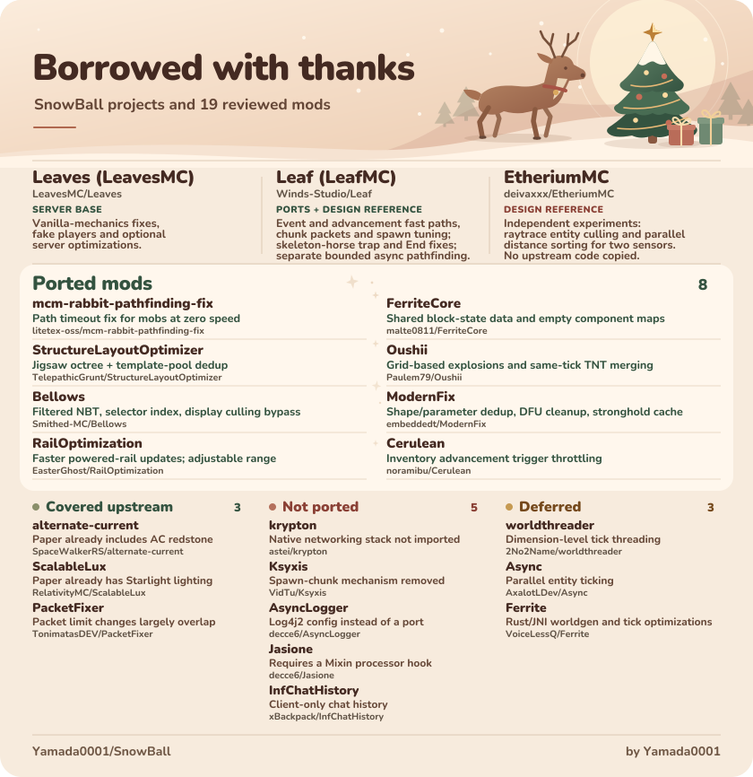

<h1 align="center">SnowBall</h1>

<p align="center">A Minecraft Java Edition server built on Leaves and Paper.</p>

<p align="center">
  
  
</p>

<p align="center">
  <strong>English</strong> · <a href="README_cn.md">简体中文</a> · <a href="https://github.com/Yamada0001/SnowBall/releases">Releases</a> · <a href="docs/CONTRIBUTING.md">Contributing</a>
</p>

<p align="center">
  
  <br>
  <sub>Illustrative tick-rate animation · Not live telemetry or a benchmark.</sub>
</p>

SnowBall carries forward vanilla-mechanics fixes, fake players, and optional optimizations from [Leaves](https://github.com/LeavesMC/Leaves) and [Paper](https://github.com/PaperMC/Paper). The exact Paper source revision is pinned in [gradle.properties](gradle.properties).

## Build and run

Install JDK 25 and use the Gradle wrapper. Run these commands from the repository root:

```bash
./gradlew applyAllPatches
./gradlew :snowball-server:createLeavesclipJar --rerun
bash scripts/GetReleaseInfo.sh --artifact-path
```

On Windows, you can use `gradlew.bat` in place of `./gradlew`; run the last command in Git Bash or check `snowball-server/build/libs` directly. The runnable distribution is `SnowBall-{Minecraft version}-{Git short SHA}.jar`. For example, a build at commit `2c62d77` for Minecraft 26.3 is named `SnowBall-26.3-2c62d77.jar`. A build from an uncommitted working tree is stamped with the current HEAD, not a new commit.

Download published builds from this repository's Releases tab. Start the distribution with `java -jar SnowBall-26.3-2c62d77.jar --nogui`, substituting your actual file name.

Back up the server before upgrading. Existing settings remain in `config/leaves.yml` and `config/SnowBall.yml`; keep both files. The `/leaves` command remains available for compatibility. Older server jars that only accept the previous release asset name need a manual first upgrade to a SnowBall jar.

## Plugin development

The Gradle modules are `snowball-api` and `snowball-server`. If your plugin uses only Bukkit or Paper APIs, its imports do not change. If it uses the fork's old extension API, update its imports to `org.snowballmc.snowball` and rebuild it against SnowBall. Legacy extension API binaries are not automatically remapped.

To use a local copy of the API, run `./gradlew :snowball-api:publishToMavenLocal` after applying the patches. Then add `mavenLocal()` to your development repositories and use the following dependency, matching the version in [gradle.properties](gradle.properties):

```kotlin
dependencies {
    compileOnly("org.snowballmc.snowball:snowball-api:26.3-R0.1-SNAPSHOT")
}
```

The Maven version naming convention does not determine the upstream Paper release channel. Releases are distributed via GitHub; remote Maven publishing is opt-in via `snowballMavenUrl` and the `SNOWBALL_MAVEN_USERNAME` and `SNOWBALL_MAVEN_PASSWORD` environment variables.

Run `./gradlew :snowball-api:test :snowball-server:test` to verify your changes. See [Contributing](docs/CONTRIBUTING.md) for the patch workflow and [LICENSE](LICENSE.md) for licensing and upstream attribution.

## Credits

<p align="center">
  
</p>

Each ported optimization names its source mod in the patch header. Porting rules and per-mod evidence are in [optimization-mod-porting-spec.md](docs/optimization-mod-porting-spec.md).
